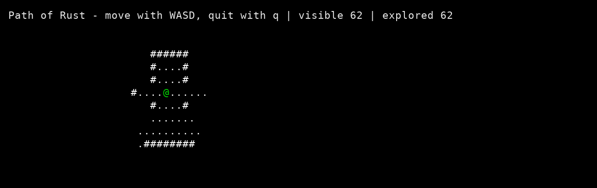
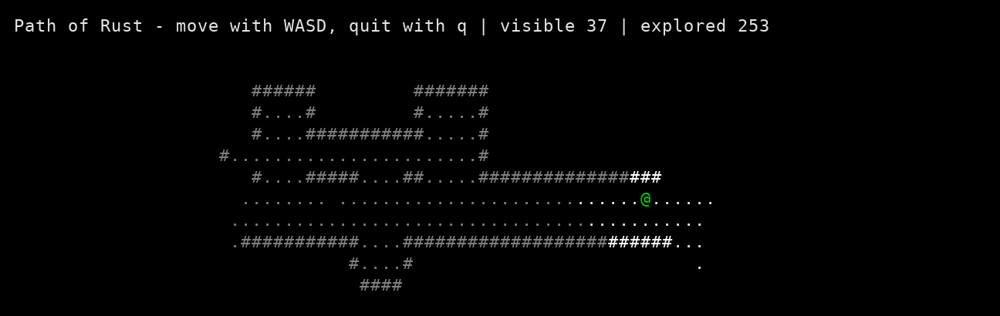

This week I implemented field of view for Path of Rust. The dungeon is still randomly generated, but the player can now only see nearby tiles with a clear line of sight. Unexplored parts of the map stay blank, and places the player has already seen remain on screen in dark gray after moving away. Step 4 is implemented through the rendering changes, with the new tests still left to write.

*Starting view: 62 tiles visible and 62 explored. The green @ is the player, # marks walls, and . marks floor tiles. Unexplored tiles stay blank.*

The line-of-sight check uses Bresenham's line algorithm to work out which grid tiles lie between the player and a target. It first checks whether the target is within the player's viewing radius, then checks the tiles along the line for walls. A wall blocks the tiles behind it, but the wall itself still needs to be visible so the player can see what is stopping them.

One detail in this step is keeping track of what the player can see right now separately from what they have seen before. Current visibility gets cleared and recalculated as the game runs. The explored map keeps its history, so leaving a room dims it instead of making it disappear. Both use the same dungeon underneath, with the drawing code deciding whether each tile should be bright, dim, or hidden.

*After exploring the same dungeon: 37 tiles visible and 253 explored. Previously visited areas remain dim gray, while the player's current view stays bright.*

I also updated the existing movement tests to include the new visibility fields. The 12 existing tests still pass, but they do not cover the new field-of-view behavior yet. The next task is to add tests for the line calculation, walls blocking sight, and visibility changing when the player moves.

After finishing those tests and the remaining checks for step 4, the next milestone on the roadmap is adding monsters that chase the player.
